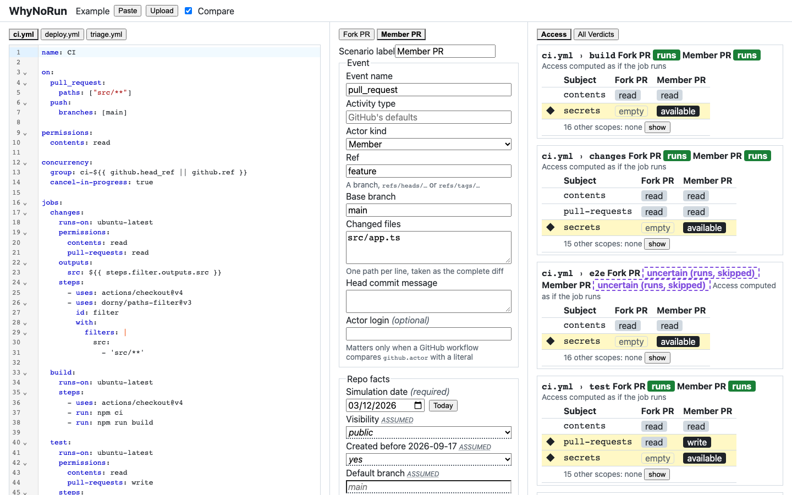
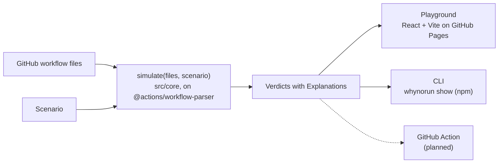

# WhyNoRun

Know what your GitHub Actions workflows will do before you push.

**Status:** 0.1.0: flow 1 works. End-term project, SST MERN 2029 batch.

[Playground](https://kunalkumarmehta.github.io/whynorun/) · [npm](https://www.npmjs.com/package/whynorun) · GitHub Action (planned for 1.0.0) · Demo video playlist (planned)

## Problem Statement

Developers who maintain GitHub Actions workflows can't safely predict what a change will do. Path and branch filters, pull requests from forks (which get no secrets and a read-only token), matrix rules and concurrency groups interact in non-obvious ways, and GitHub has no dry run. So people push and wait, and a workflow that a filter silently skips can leave a required check stuck on "Pending", blocking merges.

## Target Users

The Maintainer: the person who edits a repository's GitHub workflow files and owns its branch protection, usually on a public repo that accepts pull requests from forks.

## Solution

WhyNoRun is a browser playground _for GitHub Actions_, plus a CLI that runs the same core. You describe an Event (a push, a fork PR, a `pull_request_target`, a Dependabot run) and the Repo facts the YAML can't show, and it predicts each GitHub workflow's, job's and token scope's outcome as a Verdict. Every Verdict explains itself: the GitHub rule, the inputs it used and the YAML line responsible.

WhyNoRun explains outcomes; it doesn't lint them. For linting, use [actionlint](https://github.com/rhysd/actionlint) and [zizmor](https://github.com/zizmorcore/zizmor). Predicting whether a workflow runs isn't new either (see Credits); WhyNoRun's focus is explaining every outcome from its YAML line. When the YAML can't decide, it never guesses: the Verdict is Uncertain, lists the possible outcomes unranked, and names the input that would settle it.

## Key Features

### Access report (core flow 1)

Pick a Scenario (a push, a same-repo or fork pull request, `pull_request_target` or a Dependabot run) and WhyNoRun shows, for each job, its 17 `GITHUB_TOKEN` scopes as `write`, `read` or `none` and its secrets as `available`, `dependabot-only` or `empty`, computed as if the job runs. A fork pull request downgrades `write` to `read` (PERM-2) and empties the secrets (FK-2); `pull_request_target` gets a write token and secrets (FK-7), and on or after 2 December 2026 GitHub blocks it in older public repos with no event policy (PRT-2). Turn on Compare to put two Scenarios side by side, with ◆ on every difference, and click any Verdict to follow its Explanation to the YAML line.



### Merge-readiness check (core flow 2)

Planned: one badge per required check, such as Pending and blocks merge.

### Concurrency outcome (core flow 3)

Planned: whether run A is cancelled, replaced or queued when a Follow-up event arrives.

### Behaviour tests in CI (core flow 4)

Planned: pin Verdicts into a Test file, and the CLI and the Action fail a PR that changes one.

### Uncertain and Settle it

A Verdict the YAML can't decide, such as a job whose `if:` reads another job's output, is Uncertain. It lists its possible outcomes, never ranked, and Settle it offers the input that would decide it, for one Scenario only. Repo facts you haven't set take public-repo defaults and are marked _assumed_ (WN-5).

Repo import and share links are planned.

### `whynorun show`

`whynorun show --event push --date 2026-12-03` reads `.github/workflows/` in the current folder (or `--repo <dir>`) and prints one line per GitHub workflow, per job and per access key (each job's 17 `GITHUB_TOKEN` scopes and its secrets, computed as if the job runs): its value, its root rule ID and the YAML line. `--flow access` prints only the access keys. `--ref` (a branch, `refs/heads/…` or `refs/tags/…`) and `--base` give the pushed ref and a pull request's base branch for branch and tag filters; both default to the default branch. `--actor member|fork|dependabot` sets the Actor kind (a member by default). `--changed <file>` (or `-` for stdin) lists the changed files, one per line, taken as the complete diff for path filters; without it the diff is empty. It never reads git and never uses the network. Repo facts it isn't given take these assumed defaults:

<!-- show-defaults -->

- Visibility: public
- Created before 2026-09-17: yes
- Default branch: `main`
- Token default: restricted
- `pull_request_target` event policy: none
- Approval of a fork contributor's run: approved

<!-- /show-defaults -->

## What WhyNoRun always assumes

These platform conditions are taken as given and never shown as a cause:

<!-- baseline -->

- Actions are enabled for the repo, org and enterprise, and the GitHub workflow isn't disabled (PL-1, PL-2).
- The event was created: no more than 3 tags or 5,000 branches pushed at once (PL-7), and no trigger or queue rate limit is hit (PL-8).
- The event wasn't caused by `GITHUB_TOKEN` (PL-6).
- No execution-protection actor rule, no event rule other than the `pull_request_target` event policy, and no Require-lockfile policy (PL-10, PRT-6, PRT-7).
- The allowed-actions and SHA-pinning policies permit every `uses:` (PL-11).
- The pull request has no merge conflict (PL-12, DB-5).
- Environment protection rules and branch policies pass (PL-16).
- "Allow GitHub Actions to create and approve pull requests" is on (PERM-10).
- No runner-queue, run or job time limit is hit (PL-15), and there is no billing or storage stop (PL-17).

<!-- /baseline -->

## Tech Stack

- TypeScript core built on GitHub's own `@actions/workflow-parser` and `@actions/expressions`
- Node.js CLI (npm), bundled with esbuild; a JavaScript GitHub Action for CI is planned for 1.0.0
- React + Vite browser playground with CodeMirror, hosted on GitHub Pages
- Vitest and Playwright for testing; GitHub Actions for CI/CD

## Architecture

npmjs.com doesn't render Mermaid: see the diagram [on GitHub](https://github.com/KunalKumarMehta/whynorun#architecture).



One pure function, `simulate(files, scenario)`, takes the Workflow set and a Scenario and returns a Verdict for every subject. It reads no clock, no network and no git. The playground and the CLI both call it, and the CLI ships as one committed bundle, `dist/whynorun.mjs`. The decisions behind it:

- [ADR 0001: Verdict keys are outcome-independent](docs/adr/0001-outcome-independent-verdict-keys.md)
- [ADR 0002: Test files embed the core Scenario](docs/adr/0002-test-files-embed-the-core-scenario.md)
- [ADR 0003: Released artifacts only](docs/adr/0003-released-artifacts-only.md)
- [ADR 0004: Share links carry state in the URL fragment](docs/adr/0004-share-links-carry-state-in-the-url-fragment.md)

The domain vocabulary is in [GLOSSARY.md](GLOSSARY.md).

## Local Setup

You need Node.js 22 or later (CI uses 24).

```sh
npm ci
npm run dev        # the playground at http://localhost:5173/whynorun/
npm run lint
npm run typecheck
npm test
npm run build      # rebuilds dist/
npx playwright install chromium   # add --with-deps on Linux
npm run e2e
```

After changing `src/` or the dependencies, run `npm run build` and commit `dist/`, or CI fails with "dist/ is stale".

To use the CLI from a checkout, run `node dist/whynorun.mjs show --event push --date 2026-12-03 --repo <dir>`. From npm, run `npx whynorun show …`.

## Environment Variables

None required: no secrets, no config. Releases publish to npm with OIDC trusted publishing, so no token is stored.

## Deployment

- The playground: https://kunalkumarmehta.github.io/whynorun/
- The CLI: [`whynorun` on npm](https://www.npmjs.com/package/whynorun)

Pushing a `vX.Y.Z` tag runs `release.yml`, which checks the tag, publishes the committed `dist/` to npm, creates the GitHub Release from this version's CHANGELOG section and deploys the playground to Pages. Pages serves only released versions ([ADR 0003](docs/adr/0003-released-artifacts-only.md)). A released rule ID never changes meaning, and a release that changes a pinned Verdict is at least a minor version ([ADR 0002](docs/adr/0002-test-files-embed-the-core-scenario.md)). See [CHANGELOG.md](CHANGELOG.md).

A Dependabot PR that changes a bundled dependency fails the freshness check on purpose. Rebuild `dist/` yourself: `gh pr checkout <n> && npm ci && npm run build`, commit `dist/` and push.

## Privacy and security

- Everything runs in your browser or terminal. There is no backend and no account.
- All input is treated as untrusted, and the playground ships a Content Security Policy in a meta tag.

## Limitations

- Events outside v1, and impossible combinations such as a fork contributor pushing, are Unsupported (WN-3). Uncertain means the YAML and the Scenario can't decide the outcome; it never means a guess.
- No step execution: for that, use [act](https://github.com/nektos/act).
- Private repos can be simulated from pasted or uploaded YAML.
- No matrix expansion.
- Remote reusable workflows are never fetched (WN-6), and neither are the actions that steps `uses:`. Local reusable workflows are modelled one level deep.
- Changed files are typed by hand, and the CLI never reads git.
- Environment secrets aren't modelled (RU-3), and environment protection rules are assumed to pass (PL-16).

## Credits

- [`@actions/workflow-parser`](https://github.com/actions/languageservices) and `@actions/expressions` (MIT), GitHub's own parser, bundled as a dependency.
- The TypeScript port of [act](https://github.com/nektos/act)'s `workflowpattern` and its 64 test cases (MIT).
- [buildkite-gha](https://github.com/buildkite/buildkite-gha)'s trigger tests (MIT).
- [GitHub Docs](https://docs.github.com/actions), quoted in Explanations (© GitHub, CC BY 4.0).
- Prior art: run/skip prediction already exists in wrkflw, act, actionlint, zizmor, buildkite-gha, actrun, the Gitea workflow detector (MIT; its design for combining branch, tag and path filters is followed and credited), the Forgejo detector (credited, not used, because it is GPL-3.0), GitLab CI Lint and dorny/paths-filter.
- Third-party licences: [for the CLI](https://github.com/KunalKumarMehta/whynorun/blob/main/dist/THIRD_PARTY_LICENSES.md) and [for the playground](https://kunalkumarmehta.github.io/whynorun/THIRD_PARTY_LICENSES.md).
- WhyNoRun was built with AI assistance (Claude Code).

Licensed under the [MIT License](LICENSE).
