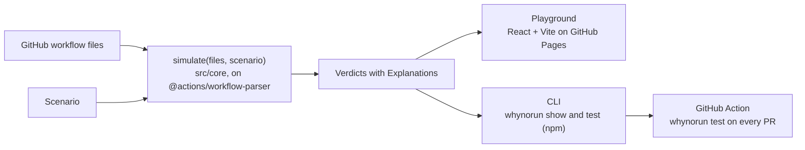

# WhyNoRun

Know what your GitHub Actions workflows will do before you push.

[Playground](https://kunalkumarmehta.github.io/whynorun/) · [npm](https://www.npmjs.com/package/whynorun) · [GitHub Action](https://github.com/KunalKumarMehta/whynorun#deployment)

End-term project, SST MERN 2029 batch.

## Problem Statement

Developers who maintain GitHub Actions workflows can't safely predict what a change will do. Path and branch filters, pull requests from forks (which get no secrets and a read-only token), matrix rules and concurrency groups interact in non-obvious ways, and GitHub has no dry run. So people push and wait, and a workflow that a filter silently skips can leave a required check stuck on "Pending", blocking merges.

## Target Users

The Maintainer: the person who edits a repository's GitHub workflow files and owns its branch protection, usually on a public repo that accepts pull requests from forks.

## Solution

WhyNoRun is a browser playground _for GitHub Actions_, plus a CLI that runs the same core. You describe an Event (a push, a fork PR, a `pull_request_target`, a Dependabot run) and the Repo facts the YAML can't show, and it predicts each GitHub workflow's, job's and token scope's outcome as a Verdict. Every Verdict explains itself: the GitHub rule, the inputs it used and the YAML line responsible.

WhyNoRun explains outcomes; it doesn't lint them. For linting, use [actionlint](https://github.com/rhysd/actionlint) and [zizmor](https://github.com/zizmorcore/zizmor). Predicting whether a workflow runs isn't new either (see Credits); WhyNoRun's focus is explaining every outcome from its YAML line. When the YAML can't decide, it never guesses: the Verdict is Uncertain, lists the possible outcomes unranked, and names the input that would settle it.

## Key Features

### Access report (core flow 1)

Pick a Scenario (a push, a same-repo or fork pull request, `pull_request_target` or a Dependabot run) and WhyNoRun shows, for each job, its 17 `GITHUB_TOKEN` scopes as `write`, `read` or `none` and its secrets as `available`, `dependabot-only` or `empty`, computed as if the job runs. A fork pull request downgrades `write` to `read` (PERM-2) and empties the secrets (FK-2); `pull_request_target` gets a write token and secrets (FK-7), and on or after 2 December 2026 GitHub blocks it in older public repos with no event policy (PRT-2). Turn on Compare to put two Scenarios side by side, with ◆ on every difference, and click any Verdict to follow its Explanation to the YAML line.


### Merge-readiness check (core flow 2)

Type your branch protection's required checks (or click Require every produced check) and the Merge readiness tab gives each one a Merge-readiness badge: Passes, Pending and blocks merge, Fails and blocks merge, May not block, or Uncertain. A check is named after the job that reports it, `name:` or the job id (RQ-0). A GitHub workflow skipped by a path, branch or commit-message filter reports nothing, so its required checks stay Pending and block merge (RQ-1): GitHub's own advice is to avoid requiring workflows that can be skipped (RQ-8). A job skipped by its own `if:` passes (RQ-2), one skipped because a `needs` dependency failed may not block (RQ-3), and a job that fails, or the "job X fails" Assumption, fails and blocks merge (RQ-4). It also counts the push of a same-repo or Dependabot pull request's head branch (PA-4), the merge queue's `merge_group` run (RQ-6), and reusable workflows' `<caller> / <callee>` check names (RQ-9). With Compare on, ◆ marks each check whose badge differs, and its Explanation names the YAML line that decided it. On the CLI, `whynorun show --from <test file> --flow checks` prints the badges for a Test file's Scenario.


### Concurrency outcome (core flow 3)

Describe a Follow-up event that arrives while run A is in progress or pending, and the Concurrency tab shows, for each `concurrency:` declared at workflow or job level, run A's and run B's outcome as `runs`, `pending`, `cancelled` or `no-run`, with the resolved group (lower-cased, with run-time placeholders such as `<run_id:A>`) next to the group as written. `cancel-in-progress: true` cancels run A and run B runs (CC-2); otherwise run B waits pending behind a running A, and replaces a pending one (CC-1). Groups ignore case (CC-4), and a property the Event leaves undefined, such as `github.head_ref` on a push, resolves to empty, so pushes to different branches can collide (CC-5). For `queue: max`, give the number of runs already pending and run B is queued, its place likely but not certain (CC-6), or cancelled once 100 wait (CC-3); `queue: max` with `cancel-in-progress: true` is GitHub's own validation error, shown as a Diagnostic (CC-3). A group shared by two GitHub workflows follows the arriving run's `cancel-in-progress` (CC-12), a local reusable workflow in its caller's group cancels its own run (CC-7), and jobs that keep running after a cancellation, such as `if: always()`, are listed as continuing (CC-9). A matrix-dependent group, a run awaiting approval, mixed `queue` modes that decide the outcome, or a run waiting on a cancelled run's continuing jobs (CC-11) is Uncertain. With Compare on, ◆ marks each run that differs. `whynorun show` prints run A's line from flags, and run A and run B with `--from <test file> --flow concurrency`.


### Behaviour tests in CI (core flow 4)

Pin the Verdicts you rely on, with the pin beside each row or Pin all in this tab, and Save as Behaviour test downloads a Test file for `.github/whynorun/`: each Scenario with every default written out, and each pin's value, possible outcomes and root rule ID. Commit it, and `whynorun test` simulates each Scenario against the repo's GitHub workflows and exits 1 when a pinned Verdict changes, printing each difference as `ci.yml › test › secrets: available → empty (root FK-0 → FK-2)`. The Action runs it on every pull request and merge group: a PR that, say, adds a `paths:` filter to a required check's GitHub workflow goes red, with an annotation on the YAML line of the new root cause and a Test, Subject, Pinned, Now table in the step summary. It never comments on the PR. Open test… loads a Test file back into the playground and marks each pin ✓ or changed, and Accept all changes rewrites the changed pins, as `whynorun test --update` does, all or nothing; Save alone never accepts a change. Only `--update` keeps your comments.

### Uncertain and Settle it

A Verdict the YAML can't decide, such as a job whose `if:` reads another job's output, is Uncertain. It lists its possible outcomes, never ranked, and Settle it offers the input that would decide it, for one Scenario only. Repo facts you haven't set take public-repo defaults and are marked _assumed_ (WN-5).

### Repo import

Import repo reads a public repository's `.github/workflows/` at one commit, with no token: give `owner/repo` or a github.com link and a ref (the default branch if you leave it empty). The header then shows `owner/repo @ sha7`, and Repo facts take the repo's visibility, creation date and default branch, tagged ⤓ imported. Edit the files freely: Reset restores the import, and Re-import refreshes it. A repo that's private or missing, a rate limit or a network failure says why and leaves the current set as it was.

### Share links and drafts

Copy link puts the Workflow set and both Scenarios into one link, compressed into its URL fragment: an unedited import travels as its repo and commit, anything else as the files themselves. Opening a link asks before replacing your work. Meanwhile the playground autosaves a draft in this browser and restores it on your next visit; Start over clears it.

### `whynorun show`

`whynorun show --event push --date 2026-12-03` reads `.github/workflows/` in the current folder (or `--repo <dir>`) and prints one line per GitHub workflow, per job, per run A of each `concurrency:` and per access key (each job's 17 `GITHUB_TOKEN` scopes and its secrets, computed as if the job runs): its value, its root rule ID and the YAML line. `--flow access` prints only the access keys. `--ref` (a branch, `refs/heads/…` or `refs/tags/…`) and `--base` give the pushed ref and a pull request's base branch for branch and tag filters; both default to the default branch. `--actor member|fork|dependabot` sets the Actor kind (a member by default). `--changed <file>` (or `-` for stdin) lists the changed files, one per line, taken as the complete diff for path filters; without it the diff is empty. `--from <test file>` (with `--scenario <label>` when the file has more than one) takes the Scenario from a Test file instead of these flags. It never reads git and never uses the network. Repo facts it isn't given take these assumed defaults:

<!-- show-defaults -->

- Visibility: public
- Created before 2026-09-17: yes
- Default branch: `main`
- Token default: restricted
- `pull_request_target` event policy: none
- Approval of a fork contributor's run: approved

<!-- /show-defaults -->

## Tech Stack

- TypeScript core built on GitHub's own `@actions/workflow-parser` and `@actions/expressions`
- Node.js CLI (npm) and a JavaScript GitHub Action, each bundled with esbuild and committed to `dist/`
- React + Vite browser playground with CodeMirror, hosted on GitHub Pages
- Vitest and Playwright for testing; GitHub Actions for CI/CD

## Architecture

npmjs.com doesn't render Mermaid: see the diagram [on GitHub](https://github.com/KunalKumarMehta/whynorun#architecture).



One pure function, `simulate(files, scenario)`, takes the Workflow set and a Scenario and returns a Verdict for every subject. It reads no clock, no network and no git. The playground and the CLI both call it, and the Action runs the CLI's `whynorun test`. The CLI and the Action ship as committed bundles, `dist/whynorun.mjs` and `dist/action.mjs`. The decisions behind it:

- [ADR 0001: Verdict keys are outcome-independent](docs/adr/0001-outcome-independent-verdict-keys.md)
- [ADR 0002: Test files embed the core Scenario](docs/adr/0002-test-files-embed-the-core-scenario.md)
- [ADR 0003: Released artifacts only](docs/adr/0003-released-artifacts-only.md)
- [ADR 0004: Share links carry state in the URL fragment](docs/adr/0004-share-links-carry-state-in-the-url-fragment.md)

The domain vocabulary is in [GLOSSARY.md](GLOSSARY.md).

## Local Setup

You need Node.js 22 or later (CI uses 24).

```sh
npm ci
npm run dev        # the playground at http://localhost:5173/whynorun/
npm run lint
npm run typecheck
npm test
npm run build      # rebuilds dist/
npx playwright install chromium   # add --with-deps on Linux
npm run e2e
```

After changing `src/` or the dependencies, run `npm run build` and commit `dist/`, or CI fails with "dist/ is stale".

To use the CLI from a checkout, run `node dist/whynorun.mjs show --event push --date 2026-12-03 --repo <dir>`, or `node dist/whynorun.mjs test` in a repo with Test files. From npm, run `npx whynorun show …` or `npx whynorun test`.

## Environment Variables

None required: no secrets, no config.

- In CI, the runner sets `GITHUB_ACTIONS`, which turns on `whynorun test`'s annotations, and `GITHUB_STEP_SUMMARY`, the file its diff table goes into. Setting `GITHUB_ACTIONS=true` locally reproduces the CI output.
- The Action takes one input, `with: tests`: Test file glob patterns, one per line, defaulting to `.github/whynorun/**/*.test.yml`.
- Import, Re-import and opening a reference share link call api.github.com and raw.githubusercontent.com without a token, on your own limit of 60 calls an hour.
- Releases publish to npm with OIDC trusted publishing, so no token is stored.

## Deployment

- The playground: https://kunalkumarmehta.github.io/whynorun/
- The CLI: [`whynorun` on npm](https://www.npmjs.com/package/whynorun)
- The Action: `KunalKumarMehta/whynorun`, from this repository

To run your Behaviour tests on every pull request, commit your Test files under `.github/whynorun/` and add `.github/workflows/whynorun.yml`:

```yaml
name: whynorun

# No paths: filter, so the required check always reports.
on:
  pull_request:
  merge_group:

permissions:
  contents: read

jobs:
  whynorun:
    runs-on: ubuntu-latest
    steps:
      - uses: actions/checkout@v7
        with:
          persist-credentials: false
      - uses: KunalKumarMehta/whynorun@v1.0.0
```

Checkout comes first: the Action reads the checked-out files and exits 2 without them. Keep the exact tag current with `.github/dependabot.yml`:

```yaml
version: 2
updates:
  - package-ecosystem: github-actions
    directory: /
    schedule:
      interval: weekly
    allow:
      - dependency-name: KunalKumarMehta/whynorun
```

Then mark the `whynorun` check as required in your branch protection or ruleset, so a pull request that changes a pinned Verdict can't merge.

Every Test file the playground writes starts with this line, so an editor with the YAML language server checks it as you edit:

```yaml
# yaml-language-server: $schema=https://cdn.jsdelivr.net/npm/whynorun@1/schemas/test-file.schema.json
```

`whynorun test` runs the same check locally:

```sh
npx whynorun test                  # every .github/whynorun/**/*.test.yml, against .github/workflows/
npx whynorun test 'tests/*.test.yml'
npx whynorun test --json           # one JSON document on stdout, "format": 1
npx whynorun test --update         # accept the changed pins in place, keeping comments
```

It exits 0 when every pin matches; 1 when a pin changed, a pinned or assumed subject wasn't found, a file has Diagnostics or a Scenario is unsupported; and 2 for an invalid or unreadable Test file, no Test files, or misuse. `--update` writes nothing unless it can accept every change.

Pushing a `vX.Y.Z` tag runs `release.yml`, which checks the tag, publishes the committed `dist/` to npm, creates the GitHub Release from this version's CHANGELOG section and deploys the playground to Pages. Pages serves only released versions ([ADR 0003](docs/adr/0003-released-artifacts-only.md)). A released rule ID never changes meaning, and a release that changes a pinned Verdict is at least a minor version ([ADR 0002](docs/adr/0002-test-files-embed-the-core-scenario.md)). See [CHANGELOG.md](CHANGELOG.md). From `1.0.0` each release also moves the `v1` tag, but the example above pins an exact tag, so a release whose rules change a pinned Verdict arrives as its own Dependabot PR, which `whynorun test` turns red: accept the change with `whynorun test --update`.

A Dependabot PR that changes a bundled dependency fails the freshness check on purpose. Rebuild `dist/` yourself: `gh pr checkout <n> && npm ci && npm run build`, commit `dist/` and push.

## What WhyNoRun always assumes

These platform conditions are taken as given and never shown as a cause:

<!-- baseline -->

- Actions are enabled for the repo, org and enterprise, and the GitHub workflow isn't disabled (PL-1, PL-2).
- The event was created: no more than 3 tags or 5,000 branches pushed at once (PL-7), and no trigger or queue rate limit is hit (PL-8).
- The event wasn't caused by `GITHUB_TOKEN` (PL-6).
- No execution-protection actor rule, no event rule other than the `pull_request_target` event policy, and no Require-lockfile policy (PL-10, PRT-6, PRT-7).
- The allowed-actions and SHA-pinning policies permit every `uses:` (PL-11).
- The pull request has no merge conflict (PL-12, DB-5).
- Environment protection rules and branch policies pass (PL-16).
- "Allow GitHub Actions to create and approve pull requests" is on (PERM-10).
- No runner-queue, run or job time limit is hit (PL-15), and there is no billing or storage stop (PL-17).

<!-- /baseline -->

## Privacy and security

- Everything runs in your browser or terminal. There is no backend and no account.
- Drafts live only in this browser, and Safari deletes them after 7 days without a visit, so a Test file is the durable save.
- Share links carry their state in the URL fragment, which the browser never sends to a server. Anyone with the link sees its files and Scenarios.
- All input is treated as untrusted: pasted and uploaded YAML, Test files, drafts and share links are all checked before anything loads.
- The playground sets a Content Security Policy in a meta tag, since Pages can't send headers: `default-src 'self'; script-src 'self'; style-src 'self' 'unsafe-inline'; connect-src https://api.github.com https://raw.githubusercontent.com; object-src 'none'; base-uri 'none'`.
- Import, Re-import and opening a reference share link call api.github.com and raw.githubusercontent.com without a token, on your own limit of 60 calls an hour.

## Limitations

- Events outside v1, and impossible combinations such as a fork contributor pushing, are Unsupported (WN-3). Uncertain means the YAML and the Scenario can't decide the outcome; it never means a guess.
- No step execution: for that, use [act](https://github.com/nektos/act).
- Private repos can be simulated from pasted or uploaded YAML; only Import needs a public repo. A fork contributor on a private repo is Unsupported.
- No matrix expansion.
- Remote reusable workflows are never fetched (WN-6), and neither are the actions that steps `uses:`. Local reusable workflows are modelled one level deep.
- Changed files are typed by hand, and the CLI never reads git.
- Environment secrets aren't modelled (RU-3), and environment protection rules are assumed to pass (PL-16).
- Only one A-then-B pair: one run A and one Follow-up event per Scenario.

## Credits

- [`@actions/workflow-parser`](https://github.com/actions/languageservices) and `@actions/expressions` (MIT), GitHub's own parser, bundled as a dependency.
- The TypeScript port of [act](https://github.com/nektos/act)'s `workflowpattern` and its 64 test cases (MIT).
- [buildkite-gha](https://github.com/buildkite/buildkite-gha)'s trigger tests (MIT).
- [GitHub Docs](https://docs.github.com/actions), quoted in Explanations (© GitHub, CC BY 4.0).
- Prior art: run/skip prediction already exists in wrkflw, act, actionlint, zizmor, buildkite-gha, actrun, the Gitea workflow detector (MIT; its design for combining branch, tag and path filters is followed and credited), the Forgejo detector (credited, not used, because it is GPL-3.0), GitLab CI Lint and dorny/paths-filter.
- Third-party licences: [for the CLI](https://github.com/KunalKumarMehta/whynorun/blob/main/dist/THIRD_PARTY_LICENSES.md) and [for the playground](https://kunalkumarmehta.github.io/whynorun/THIRD_PARTY_LICENSES.md).
- WhyNoRun was built with AI assistance (Claude Code).

Licensed under the [MIT License](LICENSE).
